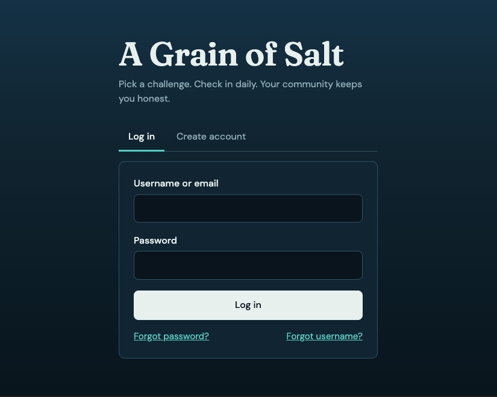

# A Grain of Salt 🧂

A full-stack challenge tracker with real-time updates and community accountability. Pick a challenge, log your progress, and get a little salt from the community to keep you going.

### Image 


### Features
Sign up, log in, and recover your account
One-time onboarding questionnaire
Choose a challenge and track your stats
Leaderboard to see how you rank
Inbox for the “grains of salt” you receive

### Tech Stack
MERN
MongoDB for the database
Express and Node.js for the backend API
React for the frontend

### Status 
in progress

### Run locally

Use Node.js 22.12 or newer. In two terminals:

```sh
cd server
npm install
npm run dev
```

```sh
cd client
npm install
npm run dev
```

Configure `server/.env` using `server/.env.example`. MongoDB must be reachable before the API starts. Open the Vite URL (normally http://localhost:5173). The development server proxies `/api` to port 5000; update `client/vite.config.js` if you change the API port.

### Recover your account

On `/login`, choose **Forgot your password?** and enter the email used for signup. For local development without email settings, copy the reset link printed in the **server terminal** into your browser. Choose and confirm a new password, then return to login. Links expire after 30 minutes and work once. Requesting a new link replaces the previous one; resetting your password signs out existing sessions.

For email delivery, configure `RESEND_API_KEY` and `EMAIL_FROM` with a verified sender. Production requires both settings and `CLIENT_URL` set to the public frontend URL. Recovery requests always show the same response whether an account exists; check server logs if delivery fails. The recovery rate limit is per server process; multiple-instance deployments should use a shared rate-limit store.

For deployment, route `/api` to the backend on the same site and configure the frontend host to serve `index.html` for React routes, including `/reset-password`. `VITE_API_URL` can override the auth API base URL when needed. Cross-site hosting also requires matching cookie and CORS configuration.

Validation: `npm run build --prefix client`, `npm run lint --prefix client`, and `npm test --prefix server`. Backend tests use a simulated database and email sender.

### Older account format

For databases created with the old `local.email` and `local.password` format, run `npm run migrate:users --prefix server` once. The migration checks for duplicate emails before writing, copies existing password hashes to the current fields, normalizes emails, and replaces the old `local.email` unique index with email and username indexes. Legacy fields are retained.
